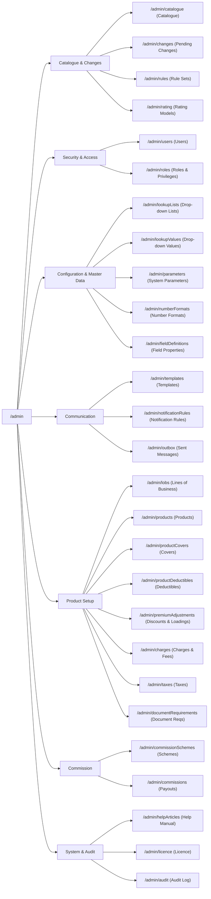
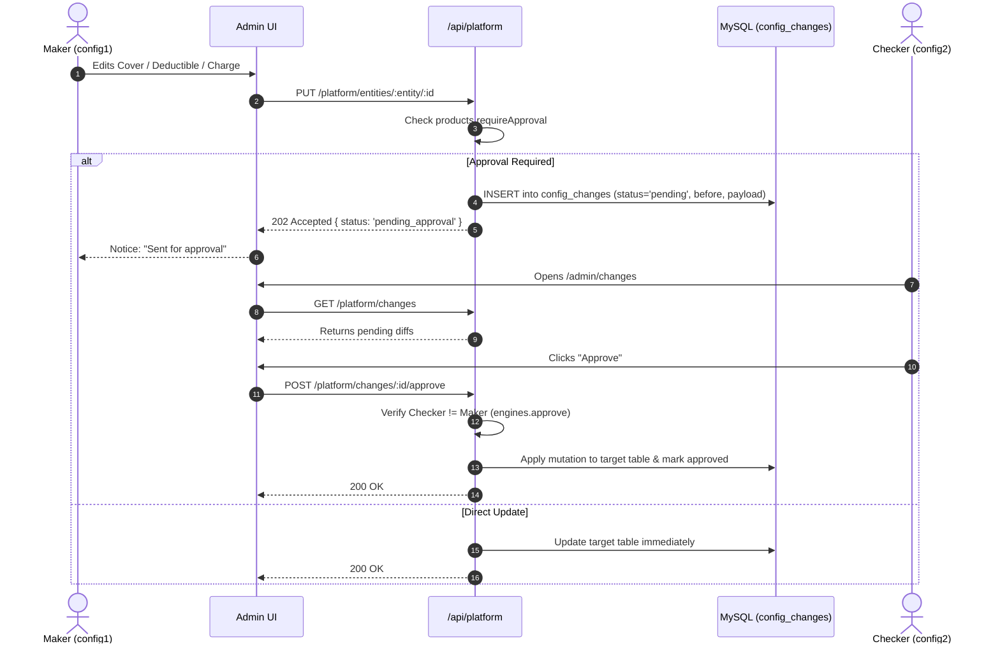

# 00. Administration Architecture, Navigation Map & Glossary

This document outlines the core architecture, security and permissions framework, operational workflows, and domain glossary for the Insurance Platform Administration Console (`http://localhost:3000/en/admin`).

---

## 1. Architectural Principles

The administration console operates on five foundational design principles:

1. **Zero-Downtime Configuration (No Deployments)**: All product lines, pricing rules, tax tables, drop-down options, document requirements, and UI field properties are stored in MySQL and evaluated dynamically by the API (`/api/platform`, `/api/engines`). Changing a rate, discount, or label takes effect immediately for all subsequent quotes.
2. **Four-Eyes Maker-Checker Governance**: Sensitive operations—including rate tables, rating models, rule sets, and product configuration changes—support maker-checker separation. A creator cannot approve their own changes.
3. **First-Class Bilingualism**: All customer- and broker-facing entities store both English (`_en`) and Arabic (`_ar`) strings. The platform supports native right-to-left (RTL) rendering.
4. **Dynamic Rule & Rating Engine**: Products are rated using interpreted JSON execution trees (`Rating Models`) and condition-action rule sets (`Rule Sets`), backed by an isolated, non-eval expression parser (`api/src/lib/expr.js`).
5. **Strict Audit Trail**: Every administrative mutation (create, update, delete, reset-password, approve, reject) is captured in `audit_log` with user ID, timestamp, entity name, record ID, and before/after payloads.

---

## 2. Navigation Map

When an administrator logs in and opens `/admin`, the sidebar navigation displays sections based strictly on their granted permissions:

---

## 3. Security & Permission Architecture (RBAC)

The portal enforces a two-tier Role-Based Access Control (RBAC) model:
1. **Base Roles**: Fundamental persona categories (`config_admin`, `uw_manager`, `underwriter`, `ops`, `broker_admin`, `broker_user`, `customer`, `risk_engineer`).
2. **Permissions (Privileges)**: Granular capability strings checked by API middleware (`requirePermission('...')`).

### Administrative Permissions Matrix

| Permission Code | Module | Purpose | Default Roles |
|---|---|---|---|
| `admin.access` | `admin` | Mandatory permission to open any `/admin/*` route | `config_admin`, `uw_manager`, `ops` |
| `admin.users` | `admin` | Create users, reset temporary passwords, activate/deactivate accounts | `config_admin` |
| `admin.roles` | `admin` | Create custom roles and toggle assigned permission checkboxes | `config_admin` |
| `admin.products` | `admin` | Access product catalogue, configure LOBs, products, covers, deductibles, charges, taxes | `config_admin` |
| `admin.rules` | `admin` | Create, edit, and test dynamic rule sets and decision tables | `config_admin`, `uw_manager` |
| `admin.rating` | `admin` | Configure and edit dynamic rating models | `config_admin` |
| `engines.approve` | `rating` | Checker authority: approve or reject rule sets, rating models, and pending config changes | `config_admin`, `uw_manager` |
| `admin.lookups` | `admin` | Manage master drop-down lists and values | `config_admin` |
| `admin.parameters`| `admin` | Edit system parameters (session timeouts, OTP limits, SMTP settings) | `config_admin` |
| `admin.numbering` | `admin` | Manage sequential numbering templates for quotes, policies, claims | `config_admin` |
| `admin.templates` | `admin` | Manage email, SMS, and in-app message templates; send test emails | `config_admin` |
| `admin.notifications`| `admin`| Map platform business events to templates and recipient channels | `config_admin` |
| `admin.outbox` | `admin` | Read-only inspection of dispatched and failed messages | `config_admin`, `ops` |
| `admin.commission`| `admin` | Manage broker commission schemes and mark earned payouts as paid | `config_admin`, `uw_manager`, `ops` |
| `admin.licence` | `admin` | Install tenant licence keys; monitor seat and module limits | `config_admin` |
| `admin.fields` | `admin` | Manage UI screen labels, tooltips, validation regex, and mandatory flags | `config_admin` |
| `admin.help` | `admin` | Author bilingual markdown articles for the online help centre | `config_admin` |
| `admin.audit` | `admin` | Inspect the immutable configuration and authentication audit trail | `config_admin`, `uw_manager` |

---

## 4. The Two-Phase Approval Workflow

The platform provides built-in maker-checker separation across two engines:

### A. Dedicated Engine Governance (Rule Sets & Rating Models)
- **Draft Status**: Created or cloned by a maker (`admin.rules` or `admin.rating`).
- **Test Bench**: Draft must be tested on the built-in test bench against fact payloads or sample quotes.
- **Submission**: Submitting requires all unit test cases to pass (`100% passed`). Status transitions to `pending`.
- **Approval / Rejection**: A user with `engines.approve` (who is **not** the maker or submitter) reviews and approves. Approval marks the version `published`, supersedes prior published versions, and activates live dynamic rating.

### B. Product Configuration Approval Workflow (`Pending Changes`)
- Controlled by system parameter `products.requireApproval` (boolean).
- When `products.requireApproval` is `false`, changes to LOBs, products, covers, deductibles, discounts, loadings, charges, taxes, and document requirements apply immediately.
- When `products.requireApproval` is `true`:
  1. The API intercepts the POST/PUT/DELETE request and validates the payload shape immediately.
  2. The change is staged in table `config_changes` with status `pending`.
  3. The maker sees `"Sent for approval. A second person must approve the change before it takes effect."`
  4. The checker visits `/admin/changes`, inspects the field-by-field Before/After diff table, and clicks **Approve** or **Reject**.

---

## 5. Domain Glossary

| Term | Definition in Platform Context |
|---|---|
| **Line of Business (LOB)** | Top-level insurance domain (`fire`, `marine`, `wc`, `engineering`). Products inherit their statutory licensing code from the LOB. |
| **Product** | An insurance product (e.g. `FIRE`, `MARINE`, `WC`, `ENG`) with distinct coverage options, rules, and rating algorithms. |
| **Cover** | A peril, clause, or extension under a product. Can be `basic` (mandatory core peril), `optional` (add-on purchased for additional premium), or `clause` (e.g., Marine Institute Cargo Clauses ICC-A). |
| **Deductible** | The initial amount or percentage of a claim borne by the policyholder. Can be `fixed`, `percent_of_claim`, `percent_of_si`, `greater_of`, or `days` (time deductible). |
| **Premium Adjustment** | A post-rating percentage discount or loading applied dynamically based on risk facts (e.g., claims history, distribution channel, workforce size). |
| **Charge / Policy Fee** | Additional fixed or percentage levy (such as policy issuance fees) added to the technical premium before or after taxation. |
| **Tax** | Statutory tax or VAT (e.g., 5% UAE VAT) configured per country and product, with rules defining whether policy fees are taxable. |
| **Dynamic Rating Model** | A JSON calculation tree of sequential execution steps (`set`, `each`, `checkpoint`, `error`, `return`, `fail`) that calculates premiums without modifying backend code. |
| **Rule Set** | A versioned collection of underwriting or eligibility rules evaluated against risk facts to trigger referrals (`refer`), online declinations (`decline`), informational messages, or variable transformations (`set`). |
| **Decision Table** | A tabular multi-condition rule matrix within a Rule Set with designated hit policies (`first` match or `collect` all). |
| **Commission Scheme** | Rules governing broker compensation rates based on broker firm, broker tier (`standard` or `preferred`), product, country, transaction type, and date windows. |
| **Clawback** | Reversal of broker commission caused by mid-term policy cancellation or premium reduction endorsements. |
| **Outbox** | Platform message store tracking every dispatch attempt across email, SMS, WhatsApp, and in-app notification channels. |
| **Licence Seat** | A licensed concurrent active staff user account. Adding active staff accounts is blocked when `seatsUsed >= maxUsers`. |
