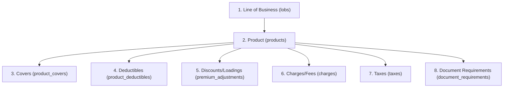

# 01. Getting Started: Recommended Setup Order

When commissioning a new tenant or setting up an insurance line from scratch, configuration entities must be created in a strict topological order. Violating this sequence leads to broken foreign key references, missing drop-down options, failed seat assertions, or unpriced quotes.

---

## Complete Dependency Map

```mermaid
graph TD
    classDef foundation fill:#e1f5fe,stroke:#0288d1,stroke-width:2px;
    classDef product fill:#e8f5e9,stroke:#388e3c,stroke-width:2px;
    classDef engine fill:#fff3e0,stroke:#f57c00,stroke-width:2px;
    classDef comms fill:#f3e5f5,stroke:#7b1fa2,stroke-width:2px;

    Licence["1. Platform Licence (/admin/licence)"]:::foundation
    Roles["2. Roles & Privileges (/admin/roles)"]:::foundation
    Users["3. Users (/admin/users)"]:::foundation
    Lookups["4. Drop-down Lists & Values (/admin/lookupLists, /admin/lookupValues)"]:::foundation
    Params["5. System Parameters (/admin/parameters)"]:::foundation
    Numbers["6. Number Formats (/admin/numberFormats)"]:::foundation

    LOB["7. Lines of Business (/admin/lobs)"]:::product
    PROD["8. Products (/admin/products)"]:::product
    Covers["9. Covers (/admin/productCovers)"]:::product
    Deductibles["10. Deductibles (/admin/productDeductibles)"]:::product
    Adjustments["11. Discounts & Loadings (/admin/premiumAdjustments)"]:::product
    Charges["12. Charges & Fees (/admin/charges)"]:::product
    Taxes["13. Taxes (/admin/taxes)"]:::product

    Rules["14. Rule Sets (/admin/rules)"]:::engine
    Rating["15. Rating Models (/admin/rating)"]:::engine
    DocReqs["16. Document Requirements (/admin/documentRequirements)"]:::engine
    FieldDefs["17. Field Properties (/admin/fieldDefinitions)"]:::engine

    Templates["18. Email/SMS Templates (/admin/templates)"]:::comms
    Notifs["19. Notification Rules (/admin/notificationRules)"]:::comms
    Commission["20. Commission Schemes (/admin/commissionSchemes)"]:::comms
    Catalogue["21. Catalogue Verification (/admin/catalogue)"]:::product

    Licence --> Users
    Roles --> Users
    Lookups --> DocReqs
    Lookups --> FieldDefs
    LOB --> PROD
    PROD --> Covers
    PROD --> Deductibles
    PROD --> Adjustments
    PROD --> Charges
    PROD --> Taxes
    PROD --> Rules
    PROD --> Rating
    PROD --> DocReqs
    PROD --> Commission
    Templates --> Notifs
    PROD --> Catalogue
```

---

## Phase-by-Phase Setup Sequence

### Phase 1: Tenant Foundation & Access Control
1. **Platform Licence (`/admin/licence`)**:
   - *Why first*: Without an active licence key specifying licensed modules (e.g. `FIRE`, `MARINE`, `WC`, `ENGINEERING`, `B2C`, `B2B`) and `maxUsers`, adding active staff users will fail with `SEATS_EXCEEDED`, and quoting will throw `LICENCE_EXPIRED`.
2. **Roles and Privileges (`/admin/roles`)**:
   - Verify built-in system roles (`config_admin`, `uw_manager`, `underwriter`, `ops`, `broker_admin`, `broker_user`, `customer`, `risk_engineer`).
   - Create custom roles if specialized privilege combinations are needed.
3. **Users (`/admin/users`)**:
   - Provision configuration administrators (at least two users: a **Maker** e.g. `config1@portal.test` and a **Checker** e.g. `config2@portal.test`).
   - Provision underwriter managers, operations, and broker agency administrators.
4. **Master Drop-down Lists & Values (`/admin/lookupLists`, `/admin/lookupValues`)**:
   - Create list containers first (`code`, `name`, `product_code`).
   - Populate bilingual values (`label_en`, `label_ar`, `parent_code` for cascading lists, `sort`, `attributes`).
   - *Prerequisite for*: Document requirements (uses `GLOBAL.documentTypes`) and Field Properties (`lookup_list`).
5. **System Parameters (`/admin/parameters`)**:
   - Set core tenant parameters: `general.insurerName`, `general.supportEmail`, `security.sessionHours`, `security.otpMinutes`.
   - Configure SMTP credentials if live emails are to be sent (`email.smtp.enabled`, `host`, `port`, `user`, `password`).
   - Set document limits (`documents.maxSizeMb`, `documents.allowedTypes`).
   - Enable `products.requireApproval` if maker-checker separation is desired.
6. **Number Formats (`/admin/numberFormats`)**:
   - Establish sequential document templates for quotes (`quote`), renewal quotes (`renewal_quote`), policies (`policy`), claims (`claim`), endorsements (`endorsement`), invoices (`invoice`), and certificates (`certificate`).

---

### Phase 2: Product Setup Hierarchy
All entities in this phase belong to the target product. If `products.requireApproval` is enabled, mutations will wait in `/admin/changes` for checker approval.

7. **Lines of Business (`/admin/lobs`)**:
   - Define statutory parent lines (`code`, `name_en`, `name_ar`, `sort`). Examples: `fire`, `marine`, `wc`, `engineering`, `motor`.
8. **Products (`/admin/products`)**:
   - Establish product records linked to the LOB (`line`). Set initial status to `draft` while configuring.
9. **Covers (`/admin/productCovers`)**:
   - Define `basic` perils (mandatory core covers included in base price).
   - Define `clause` items (e.g. ICC-A, ICC-B, ICC-C).
   - Define `optional` add-on covers with pricing methods (`loading`, `rate_on_total`, `per_head`, `fixed`, or `referral_only`).
10. **Deductibles (`/admin/productDeductibles`)**:
    - Configure deductible options per product with type (`fixed`, `percent_of_claim`, `percent_of_si`, `greater_of`, `days`).
    - Specify `amount`, `percent`, `rating_factor` (e.g. `0.92` for 8% discount), and mark one as `is_default`.
11. **Discounts and Loadings (`/admin/premiumAdjustments`)**:
    - Set post-rating percentage adjustments. Specify eligibility conditions (JSON expressions), channel applicability (`b2c`, `b2b`), priority, and `stackable` flags.
12. **Charges and Fees (`/admin/charges`)**:
    - Define policy issuance fees, inspection fees, or municipal levies (`fixed` or `percent` of premium with `min_amount`/`max_amount`).
    - Define taxability (`taxable: true`) and refundability (`refundable: false`).
13. **Taxes (`/admin/taxes`)**:
    - Configure VAT or statutory insurance premium tax (IPT) by country and product (e.g. AE 5% VAT). Set `applies_to_fees: true` to tax charges.

---

### Phase 3: Dynamic Engines (Rules & Rating)
14. **Rule Sets (`/admin/rules`)**:
    - Create a rule set for `underwriting` or `eligibility`.
    - Add individual rules with expression-based conditions (e.g. `maxLocationSI > 5000000 && hazard == 'high'`) and actions (`refer`, `decline`, `message`, `set`).
    - Add decision tables for multi-factor underwriting matrices.
    - Write unit test cases asserting expected referrals or declines.
    - Run tests on the test bench (100% must pass), submit for approval, and have a second user approve and publish version 1.
15. **Rating Models (`/admin/rating`)**:
    - Configure dynamic calculation steps in JSON (`set`, `each`, `checkpoint`, `error`, `return`, `fail`).
    - Validate expressions and run side-by-side comparisons on the test bench against sample risks.
    - Submit draft, approve with checker account, and publish version 1. Publishing automatically updates `products.rater = 'dynamic'`.

---

### Phase 4: Screen Experience & Documentation
16. **Document Requirements (`/admin/documentRequirements`)**:
    - Configure required uploads by product and event (`claim`, `referral`, `policy`, `survey`).
    - Link to `doc_type` from `lookup_values`. Set `mandatory` flag and optional conditions (e.g. Police report only when `cause == 'theft'`).
17. **Field Properties (`/admin/fieldDefinitions`)**:
    - Customize UI form behavior per screen and field key: override labels, add bilingual tooltips, set min/max validation ranges, regex patterns, or bind to drop-down lists.
18. **Help Manual (`/admin/helpArticles`)**:
    - Publish bilingual markdown guides tailored to target audiences (`["customer", "broker", "staff"]`).

---

### Phase 5: Communication & Commercials
19. **Message Templates (`/admin/templates`)**:
    - Create bilingual email, SMS, and in-app templates with `{{placeholder}}` interpolation tokens. Send a test email to verify SMTP.
20. **Notification Rules (`/admin/notificationRules`)**:
    - Map platform events (`quote.saved`, `referral.created`, `policy.issued`, `claim.registered`, `document.uploaded`) to channels (`email`, `sms`, `inapp`) and recipients (`customer`, `broker`, `underwriters`, `ops`).
21. **Commission Schemes (`/admin/commissionSchemes`)**:
    - Define broker compensation schedules by broker firm or tier (`standard`, `preferred`), product, country, and transaction type (`new_business`, `renewal`, `endorsement`).

---

### Phase 6: Operational Verification
22. **Product Catalogue Inspection (`/admin/catalogue`)**:
    - Open `/admin/catalogue` to verify that the product shows as `active`, countries are enabled, and child counts (covers, deductibles, adjustments, charges, taxes, rate tables, rules) are populated.
23. **End-to-End Test Journey**:
    - Execute a test quote on the portal from front-end to payment, verify that pricing, discounts, charges, taxes, document checklists, and notifications trigger properly, and verify that the transaction appears in `/admin/audit` and `/admin/outbox`.
