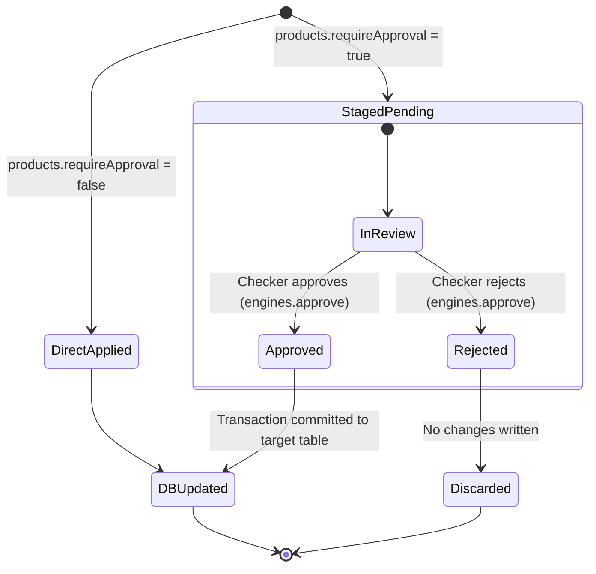

# 11. Pending Changes (Approval Workflow)

---

## 1. Overview
The **Pending Changes** module (`/admin/changes`) is the platform's central maker-checker governance queue for product configuration. When the system parameter `products.requireApproval` is set to `true`, any addition, modification, or deletion made to Lines of Business, Products, Covers, Deductibles, Discounts, Charges, Taxes, or Document Requirements is staged in a pending state with field-level diff tracking until reviewed and approved by a second authorized administrator.

---

## 2. Who Can Access
- **Queue Visibility**: Users with the `admin.products` privilege can view the pending change requests list.
- **Approval / Rejection Authority**: Users with the `engines.approve` privilege.
- **Segregation of Duties (SOD) Enforcement**: The maker who created, modified, or requested the deletion cannot approve their own change (`c.requested_by !== req.user.id`).

---

## 3. Screen Walkthrough

### List & Review Screen
- **Header**: "Pending changes" (`changes.title`) with descriptive subtitle "Product configuration changes waiting for a second person." (`changes.lead`).
- **Empty State**: Displays "No pending changes." (`changes.none`) when no approval requests are waiting.
- **Change Request Cards**: Each pending item is displayed in a dedicated card with:
  1. **Top Bar**:
     - Left: Entity name, Operation type (`create`, `update`, `delete`), and Record Key (e.g. `Covers · update · 12` or `Discounts and loadings · create`).
     - Right: Requester's full name (`Requested by {requester}`).
  2. **Field-by-Field Diff Table**:
     - Columns: `Field Name` | `Before` (original value or `—`) | `Change` (proposed new value or `—`).
     - For `update` operations: Displays only the fields that actually changed.
     - For `create` operations: Shows proposed values with `Before` as `—`.
     - For `delete` operations: Shows the existing record attributes being slated for removal.
  3. **Action Buttons**:
     - Rendered only if the signed-in user has `engines.approve` **and** is not the requester (`user.id !== c.requestedBy`).
     - **Approve and publish** (`btn-primary`): Immediately applies the change to the production table and audits the approval.
     - **Reject** (`btn-secondary`): Rejects the change request, records the rejection reason, and audits the action.

---

## 4. Field Reference Table

| Field | Type | Required | Allowed Values / Validation | Description | Example |
|---|---|---|---|---|---|
| `id` | Integer (PK) | Auto | Positive integer | Unique ID of the staged configuration change | `42` |
| `entity` | String | Yes | `lobs`, `products`, `productCovers`, `productDeductibles`, `premiumAdjustments`, `charges`, `taxes`, `documentRequirements` | Configuration entity key | `productCovers` |
| `operation` | Enum | Yes | `create`, `update`, `delete` | Type of mutation requested | `update` |
| `record_key` | String | Conditional | String representation of record PK (null for `create`) | Unique identifier of the record being mutated | `12` |
| `payload` | JSON | Conditional | Valid JSON object matching entity schema | Staged new column values (null for `delete`) | `{"amount": 3500}` |
| `before` | JSON | Conditional | Serialized snapshot of existing DB row | Snapshot of the database row prior to mutation | `{"amount": 2500}` |
| `status` | Enum | Yes | `pending`, `approved`, `rejected` | Approval lifecycle state | `pending` |
| `requested_by`| Integer (FK) | Yes | Valid user ID in `users` | Administrator who initiated the change | `3` (config1) |
| `decided_by` | Integer (FK) | No | Valid user ID in `users` | Administrator who approved or rejected | `4` (config2) |
| `decided_at` | Timestamp | No | Valid ISO timestamp | Date and time the decision was rendered | `2026-10-22 14:30:00` |
| `reason` | String | No | Max 500 characters | Optional rejection explanation | `Deductible amount violates underwriting guideline` |

---

## 5. Step-by-Step: How to Approve or Reject a Change

### Step 1: Maker Requests a Configuration Change
1. Ensure system parameter `products.requireApproval` is set to `true`.
2. As Administrator A (e.g. `config1@portal.test`), navigate to any product configuration screen (e.g., `/admin/productDeductibles`).
3. Click **Edit** on a record, alter the `Amount` from `2500` to `3500`, and click **Save**.
4. The system validates the input, stages it in the queue, and presents the banner:
   *"Sent for approval. A second person must approve the change before it takes effect."*

### Step 2: Checker Reviews and Decides
1. Sign in as Administrator B (e.g. `config2@portal.test` or an Underwriting Manager with `engines.approve`).
2. Navigate to **Admin** -> **Pending changes** (`/admin/changes`).
3. *[Screenshot Placeholder: Pending Changes Queue with Before/After Diff Table]*
4. Locate the change request card for `Deductibles · update · 1`.
5. Review the side-by-side diff:
   - Field `amount`: Before `2500` -> Change `3500`.
6. To approve: Click **Approve and publish**. The change is written to `product_deductibles`, and the request disappears from the pending queue.
7. To reject: Click **Reject**. The change is discarded, and the existing configuration remains untouched.

---

## 6. How to Edit / Deactivate / Delete Pending Requests
- **Editing Staged Changes**: Pending requests cannot be edited in place. If the proposed change has an error, the checker must **Reject** it, and the maker must submit a corrected modification.
- **Cancellation**: A maker cannot directly delete a pending change. If submitted in error, an authorized checker can simply click **Reject**.

---

## 7. Approval Flow

- **Maker Restrictions**: If the maker attempts to call `/api/platform/changes/:id/approve`, the API rejects the request with HTTP 403 `MAKER_CANNOT_APPROVE` ("A different person must approve this change").
- **Audit Tracking**: Approvals log `config.{entity}.{operation}` with the approver's user ID. Rejections log `config.change.reject`.

---

## 8. Dependencies
- **Prerequisites (What must exist BEFORE)**:
  - System parameter `products.requireApproval = true` must be enabled in `/admin/parameters` for staging to activate.
  - At least two distinct users with appropriate privileges: Maker (`admin.products`) and Checker (`engines.approve`).
- **Downstream Consumers (What uses this AFTER)**:
  - Live quote calculations immediately reflect approved changes.
  - Audit log captures the end-to-end lifecycle from creation to decision.

---

## 9. Business Rules & Validations
1. **Pre-Staging Validation**: Validation rules, data type checks, and expression syntax checks are executed **before** staging. If a maker inputs an invalid percentage (e.g., `rate = 0.8`), the request is rejected immediately with HTTP 400 `RATE_OUT_OF_RANGE` rather than creating a broken pending item.
2. **Immutable Snapshots**: The `before` snapshot captures the exact state of the database row when the change was requested.
3. **Delete Safety**: If a record has already been deleted or altered by another approved change, approving an outdated pending item will throw a conflict error.

---

## 10. Common Errors & Troubleshooting

| Error Code / Message | Cause | Resolution |
|---|---|---|
| `MAKER_CANNOT_APPROVE` | The user who requested the change is attempting to approve it. | Have a different user with `engines.approve` sign in to approve the change. |
| `CHANGE_NOT_PENDING` | The change has already been approved or rejected by another user. | Refresh the page; the item has already been processed. |
| Approval buttons do not appear | The logged-in user either requested the change or lacks `engines.approve`. | Verify user permissions in `/admin/roles` and confirm user ID differs from `requested_by`. |
| Changes apply immediately without waiting | Parameter `products.requireApproval` is set to `false`. | Open `/admin/parameters`, find `products.requireApproval`, and set to `true`. |

---

## 11. Sample Configuration
**Scenario**: An insurer increases the standard policy issuance fee from AED 50 to AED 75.
- **Maker (`config1`)**:
  - Navigates to `/admin/charges`.
  - Edits `POLICY_FEE`: sets `amount = 75`. Clicks **Save**.
- **Pending Record Created**:
  - `entity`: `charges`
  - `operation`: `update`
  - `record_key`: `1`
  - `before`: `{"code": "POLICY_FEE", "amount": 50, ...}`
  - `payload`: `{"amount": 75}`
- **Checker (`config2`)**:
  - Navigates to `/admin/changes`.
  - Reviews diff: `amount: 50 -> 75`.
  - Clicks **Approve and publish**. All new policy quotes now charge AED 75.

---

## 12. Technical Notes
- **Web Route**: `web/app/[locale]/admin/changes/page.js`
- **API Endpoints**:
  - `GET /api/platform/changes?status=pending`: Lists pending changes with requester metadata.
  - `POST /api/platform/changes/:id/approve`: Approves and applies mutation (requires `engines.approve`).
  - `POST /api/platform/changes/:id/reject`: Rejects mutation (requires `engines.approve`).
- **Database Table**: `config_changes`
  - Schema: `id`, `entity`, `operation`, `record_key`, `payload`, `before`, `status`, `requested_by`, `decided_by`, `decided_at`, `reason`, `created_at`.
- **System Parameter Key**: `products.requireApproval` (Boolean, default: `false`).
