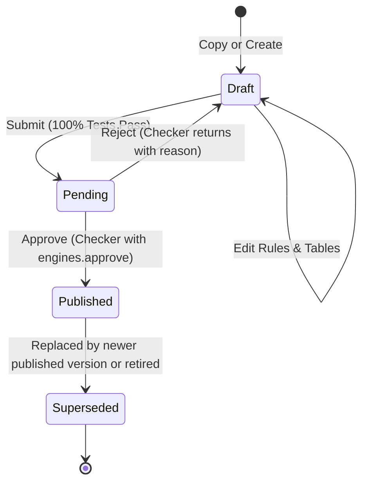

# 12. Rule Sets

---

## 1. Overview
The **Rule Sets** module (`/admin/rules`) provides an enterprise business rule engine for defining, testing, and executing underwriting referrals, online declination rules, eligibility criteria, and risk fact transformations. Rule sets are version-controlled, support condition-action rules and multi-input decision tables, and enforce automated regression test suites before changes can be submitted and published.

---

## 2. Who Can Access
- **Maker (Create, Edit, Test, Submit)**: Users with the `admin.rules` privilege.
- **Checker (Approve, Reject, Retire)**: Users with the `engines.approve` privilege.
- **Default Assigned Roles**:
  - `config_admin`: has both `admin.rules` and `engines.approve`.
  - `uw_manager`: has both `admin.rules` and `engines.approve`.
- *Maker-Checker Rule*: A user who created or submitted a rule set draft cannot approve it (`[set.created_by, set.submitted_by].includes(req.user.id)` is forbidden).

---

## 3. Screen Walkthrough

### Master List Screen
- **Header**: "Rule sets" (`engines.rules`).
- **Rule Set Cards / Table**: Displays all registered rule sets grouped by product.
  - Columns: Rule Set Name & Code, Version badge (e.g. `v1`), Summary count of rules and decision tables (e.g. `12 rules · 1 tables`), and Status badge (`draft`, `pending`, `published`, or `superseded`).
  - Clicking any rule set row opens the **Set Detail & Workbench**.

### Set Detail & Workbench
When a rule set is selected, the workbench renders four functional panels:
1. **Header Bar**:
   - Displays Set Name, Version, Product Code, Purpose (`underwriting`, `eligibility`, `validation`, `pricing`), and Code.
   - Lifecycle Action Buttons:
     - `New version` (`btn-secondary`): Clones a published or superseded rule set into a new incremental draft.
     - `Submit for approval` (`btn-primary`): Runs all unit tests. If 100% pass, transitions status from `draft` to `pending`.
     - `Approve and publish` / `Reject`: Displayed for pending sets when viewed by a non-maker with `engines.approve`.
     - `Switch off` (`retire`): Supersedes an active published rule set.
2. **Rules Panel (`engines.rulesTitle`)**:
   - Table of individual rules: Priority (numeric), Code, English/Arabic Name, Condition expression, Action badge (`refer` in warning yellow, `decline` in red, `message`, `set`), and a Delete action.
   - **Add Rule Form** (Drafts only):
     - Code, Action (`refer`, `decline`, `message`, `set`), Priority, English Name, Arabic Name.
     - Condition: Expression input (e.g. `maxLocationSI > 2000000 && hazard == 'high'`).
3. **Decision Tables Panel (`engines.tables`)**:
   - Displays tabular multi-factor underwriting matrices.
   - Shows Table Code, Name, Hit Policy (`first` or `collect`), Input expressions with column headers, and rows with cell match conditions and corresponding `then` actions.
4. **Test Bench & Test Cases (`engines.bench`)**:
   - **Facts (JSON)**: Interactive JSON scratchpad to evaluate arbitrary risk facts against the current rule set.
   - **Evaluate Button**: Runs the facts against the rule engine and prints fired rules, refer codes, decline codes, and computed variables.
   - **Run Tests Button**: Executes all saved regression test cases and displays a checkmark (`✓`) or failure (`✗`) with a detailed diff (`got ≠ expected`).
   - **Add Test Case Form**: Name, input facts JSON, and expected outcome JSON (e.g. `{"refer": ["UW-01"], "decline": []}`).

---

## 4. Field Reference Table

### Rule Set Entity (`rule_sets`)
| Field | Type | Required | Allowed Values / Validation | Description | Example |
|---|---|---|---|---|---|
| `productCode` | String | Yes | Valid code in `products` | Target product code | `FIRE` |
| `countryCode` | String | No | 2-character ISO country code or null | Territorial scope (null = all countries) | `AE` |
| `purpose` | Enum | Yes | `underwriting`, `eligibility`, `validation`, `pricing` | Functional evaluation phase | `underwriting` |
| `code` | String | Yes | `^[A-Z0-9_-]{2,40}$` | Unique identifier for the rule set family | `REFERRALS` |
| `name` | String | Yes | 2–160 characters | Commercial title of the rule set | `Fire referral rules` |
| `version` | Integer | Auto | Incremental integer (starts at 1) | Monotonically increasing version number | `1` |
| `status` | Enum | Auto | `draft`, `pending`, `published`, `superseded` | Publication lifecycle state | `published` |
| `notes` | String | No | Max 500 characters | Version release notes or reason for change | `Updated sprinkler discount threshold` |

### Rule Entity (`rules`)
| Field | Type | Required | Allowed Values / Validation | Description | Example |
|---|---|---|---|---|---|
| `code` | String | Yes | 2–30 characters | Unique rule reference code | `UW-01` |
| `nameEn` | String | Yes | 2–300 characters | Rule explanation in English | `Civil Defence certificate missing` |
| `nameAr` | String | Yes | 2–300 characters | Rule explanation in Arabic | `شهادة الدفاع المدني مفقودة` |
| `action` | Enum | Yes | `refer`, `decline`, `message`, `set` | Action triggered when condition is true | `refer` |
| `priority` | Integer | Yes | 0–10000 (default: 100) | Execution sequence (lower executes first) | `10` |
| `condition` | String / JSON | Yes | Valid expression syntax | Logical expression evaluated against facts | `!civilDefence && totalSI > 500000` |
| `params` | JSON | No | Key-value pairs (required for `set`) | Action parameters (e.g. `{"name": "hazard", "expr": "'high'"}`) | `{"name": "isHighRisk", "expr": "true"}` |
| `stop` | Boolean | No | `true`, `false` | If true, halts further rule evaluation on hit | `false` |
| `active` | Boolean | Yes | `true`, `false` | Enables or disables rule evaluation | `true` |

---

## 5. Step-by-Step: How to Create, Test & Publish a Rule Set

### Step 1: Create a New Version / Draft
1. Navigate to **Admin** -> **Rule sets** (`/admin/rules`).
2. Select an existing published rule set (e.g., `Fire referral rules`).
3. Click **New version** (`engines.copy`). The system clones all rules, decision tables, and unit tests into a new draft with an incremented version number (`v2`).
4. *[Screenshot Placeholder: Rule Set Workbench showing Draft v2 and Rules list]*

### Step 2: Add or Edit a Rule
1. Under the **Rules** panel, scroll to **Add rule**.
2. Enter Code: `UW-FIRE-VALVE`.
3. Select Action: `refer`.
4. Enter Priority: `50`.
5. Enter English Name: `Unsupervised fire valve reported`.
6. Enter Arabic Name: `صمام الحريق غير مراقب`.
7. Enter Condition: `risk.fireProtection.unsupervisedValves == true`.
8. Click **Add rule**.

### Step 3: Verify on Test Bench & Add Test Cases
1. In the **Test bench** panel, paste a sample facts JSON:
   ```json
   {
     "risk": {
       "fireProtection": {
         "unsupervisedValves": true
       }
     }
   }
   ```
2. Click **Evaluate**. Inspect the result box: verify that `refer` contains `["UW-FIRE-VALVE"]`.
3. Under **Add test case**, enter Name: `Unsupervised valve triggers referral`.
4. Enter Expected JSON:
   ```json
   {
     "refer": ["UW-FIRE-VALVE"],
     "decline": []
   }
   ```
5. Click **Add test case**.
6. Click **Run tests**. Verify that all test cases display green checkmarks (`✓`).

### Step 4: Submit for Approval
1. Click **Submit for approval** at the top of the workbench.
2. The engine executes all tests. If any test fails, submission is blocked with an error detailing expected vs received. If all pass, status changes to `pending`.

### Step 5: Checker Approval (Four-Eyes)
1. Sign in as a different administrator (e.g. `config2@portal.test`).
2. Open `/admin/rules` and select the pending rule set (`v2`).
3. Click **Approve and publish**.
4. The system executes an atomic transaction:
   - Sets previous version (`v1`) status to `superseded`.
   - Sets current version (`v2`) status to `published`.
   - Logs the approval event to `audit_log`.

---

## 6. How to Edit / Deactivate / Delete
- **Published Rule Sets**: Cannot be modified directly. Click **New version** to clone the set into a mutable draft.
- **Rules & Decision Tables**: Can only be created, edited, or deleted while the parent rule set is in `draft` status.
- **Deactivation**: Click **Switch off** (`retire`) on a published rule set to immediately supersede it without a replacement.

---

## 7. Approval Flow



---

## 8. Dependencies
- **Prerequisites (What must exist BEFORE)**:
  - Product record in `products`.
  - Understanding of risk fact schemas passed by product journeys (e.g. `maxLocationSI`, `hazard`, `civilDefence`).
- **Downstream Consumers (What uses this AFTER)**:
  - Quote engine (`api/src/modules/quotes/service.js`) calls the rule engine during quote pricing.
  - If a rule with action `refer` fires, the quote is marked `referred` and routed to the underwriter referral queue (`/admin/uw`).
  - If a rule with action `decline` fires, online purchase is blocked with a localized message.

---

## 9. Expression Language & Business Rules

### Built-in Expression Functions (`api/src/lib/expr.js`)
The engine executes a safe, sandboxed expression parser. Expressions have access to numbers, strings, booleans, arrays, objects, and safe operators (`+`, `-`, `*`, `/`, `%`, `==`, `!=`, `<`, `<=`, `>`, `>=`, `in`, `&&`, `||`, `??`, `!`, ternary `?:`).

| Function Category | Supported Functions | Example |
|---|---|---|
| **Math & Numeric** | `min`, `max`, `round`, `floor`, `ceil`, `abs`, `num`, `pos` | `max(locationSI, 1000000)` |
| **String & Inspection**| `str`, `len`, `includes`, `has`, `keys`, `values`, `coalesce` | `includes(trade, 'HAZARD')` |
| **Date & Time** | `today`, `addDays`, `addMonths`, `annualExpiry`, `daysBetween`, `monthsBetween`, `year` | `daysBetween(today(), sailingDate) < 1` |
| **Collections** | `sum`, `count`, `any`, `all`, `map`, `filter`, `find`, `max_of`, `min_of`, `product` | `any(locations, item.sumsInsured.STK > 5000000)` |
| **Domain Lookups** | `lookup`, `band`, `sumValues`, `siteKey`, `merge` | `band(totalSI, [[1e6, 0.001], [5e6, 0.0008]])` |

### Action Types
1. `refer`: Flags quote for human underwriter review.
2. `decline`: Disables online binding; displays unquotable reason.
3. `message`: Attaches an informational notice or warranty to the quote.
4. `set`: Calculates a derived fact available for subsequent rules (e.g. calculating total fleet tonnage).

---

## 10. Common Errors & Troubleshooting

| Error Code | Cause | Resolution |
|---|---|---|
| `TESTS_FAILING` | One or more unit test cases failed during submission. | Run tests in the workbench, inspect the `got ≠ expected` diff, and correct either the rule logic or the test expectation. |
| `CONDITION_INVALID` | Syntax error in condition string (e.g. unbalanced parenthesis or unknown token). | Validate expression syntax using standard operators and documented built-in functions. |
| `MAKER_CANNOT_APPROVE` | The user who created or submitted the rule set is trying to approve it. | Have a different administrator with `engines.approve` approve the set. |
| `NOT_A_DRAFT` | Attempting to edit a published or pending rule set directly. | Click **New version** to create a mutable draft. |

---

## 11. Sample Configuration: Motor Underwriting Decision Table
**Scenario**: High-performance vehicles and young drivers referral table (`UW-MOTOR-DT1`).
- **Inputs**:
  1. `driverAge`: `driver.age`
  2. `vehiclePower`: `vehicle.engineBhp`
- **Hit Policy**: `first`
- **Rows**:
  | Label | Driver Age (`driverAge`) | Engine Power (`vehiclePower`) | Action | Code | English Description |
  |---|---|---|---|---|---|
  | Young + Supercar | `< 25` | `> 350` | `decline` | `DEC-MOTOR-POWER` | High powered vehicle declined for drivers under 25 |
  | Young Driver | `< 21` | `-` | `refer` | `REF-MOTOR-YOUNG` | Driver under 21 requires senior underwriter review |
  | High Power | `-` | `> 450` | `refer` | `REF-MOTOR-POWER` | Supercar requires vehicle inspection and telematics |

---

## 12. Technical Notes
- **Web Route**: `web/app/[locale]/admin/rules/page.js`
- **API Endpoints**:
  - `GET /api/engines/rule-sets`: Lists all rule sets with counts.
  - `GET /api/engines/rule-sets/:id`: Retrieves full set content (rules, tables, tests).
  - `POST /api/engines/rule-sets/:id/copy`: Clones set to a new draft version.
  - `POST /api/engines/rule-sets/:id/rules`: Adds a rule to a draft set.
  - `POST /api/engines/rule-sets/:id/evaluate`: Evaluates arbitrary facts against the set.
  - `POST /api/engines/rule-sets/:id/run-tests`: Executes all test cases.
  - `POST /api/engines/rule-sets/:id/submit`: Validates all tests pass and sets status to `pending`.
  - `POST /api/engines/rule-sets/:id/approve`: Publishes the set (requires `engines.approve`).
- **Database Tables**: `rule_sets`, `rules`, `decision_tables`, `rule_tests`.
