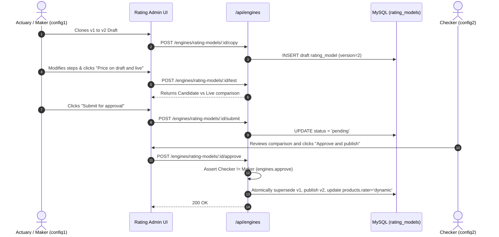

# 13. Rating Models

---

## 1. Overview
The **Rating Models** module (`/admin/rating`) provides the platform's dynamic rating engine. It allows actuaries and configuration administrators to define, validate, and publish complex insurance premium calculation algorithms entirely as structured JSON calculation models without writing or deploying backend code. The dynamic engine prices quotes, handles multi-entry calculations (e.g. open covers, certificates, contractor fleets), and provides an interactive side-by-side comparison test bench against live published models.

---

## 2. Who Can Access
- **Maker (Create, Edit Draft, Run Test Bench, Submit)**: Users with the `admin.rating` privilege.
- **Checker (Approve, Reject)**: Users with the `engines.approve` privilege.
- **Default Assigned Roles**:
  - `config_admin`: has both `admin.rating` and `engines.approve`.
  - `uw_manager`: has `engines.approve`.
- *Maker-Checker Enforcement*: The user who created or submitted a rating model draft cannot approve it (`[m.created_by, m.submitted_by].includes(req.user.id)` is strictly forbidden).

---

## 3. Screen Walkthrough

### Master Rating Engine Dashboard
- **Header**: "Rating models" (`engines.rating`).
- **Product Engine Status Row**: Displays pill badges for all products indicating whether they run on the dynamic engine or legacy coded rater:
  - `FIRE: dynamic`
  - `MARINE: dynamic`
  - `WC: dynamic`
  - `ENG: dynamic`
- **Models Table**:
  - Lists all versions: Product Code, Version (e.g. `FIRE v1`), Notes, Step count (e.g. `48 steps`), and Status badge (`published`, `pending`, `draft`, `superseded`).
  - Clicking any model row opens the **Model Editor & Test Bench Workbench**.
- **Supported Functions Accordion**: Expandable panel listing all available mathematical, string, array, and date functions available in rating expressions.

### Model Editor & Test Bench Workbench
When a model is selected, the workbench presents:
1. **Model Header**: Product Code, Version, Status badge, and Lifecycle Action Buttons:
   - `New version` (`btn-secondary`): Clones a published or superseded model into a mutable draft (`v + 1`).
   - `Validate and save` (`btn-secondary`): Validates that every expression in the model parses correctly and saves the draft.
   - `Submit for approval` (`btn-primary`): Runs full schema validation and transitions status to `pending`.
   - `Approve and publish` / `Reject`: Rendered for pending models when viewed by an authorized checker.
2. **Model Definition Panel (`engines.model`)**:
   - Monospace JSON code editor containing the complete rating tree (steps, entries, outputs).
   - Read-only for published or superseded models; fully editable for drafts.
3. **Interactive Test Bench (`engines.bench`)**:
   - **Sample Risk JSON Editor**: Pre-populated with realistic risk fixtures for the selected product (e.g. Fire shop with sum insured, Marine shipment, WC workforce, or Engineering CAR project).
   - **Compare Button (`engines.compare`)**: Executes the sample risk against both the candidate draft model and the currently published live model.
   - **Side-by-Side Result Cards**:
     - **This version (Candidate)**: Quotability status, Technical Premium, Loaded Premium, Policy Fee, VAT Tax, Total Premium, and Referral reasons.
     - **Live Model**: Identical breakdown produced by the current production rater for instant parity verification.

---

## 4. Field Reference Table

### Rating Model Entity (`rating_models`)
| Field | Type | Required | Allowed Values / Validation | Description | Example |
|---|---|---|---|---|---|
| `id` | Integer (PK) | Auto | Positive integer | Unique model identifier | `1` |
| `product_code` | String (FK) | Yes | Valid code in `products` | Associated insurance product | `FIRE` |
| `country_code` | String | No | 2-character ISO country code or null | Territorial scope (null = global default) | `AE` |
| `version` | Integer | Auto | Incremental integer | Version number | `2` |
| `status` | Enum | Auto | `draft`, `pending`, `published`, `superseded` | Publication state | `published` |
| `model` | JSON Object | Yes | Valid Rating Engine JSON tree | Complete calculation definition | *See schema below* |
| `notes` | String | No | Max 500 characters | Version release description | `Updated industrial fire base rates` |
| `created_by` | Integer (FK) | Yes | Valid user ID in `users` | Administrator who created the draft | `3` |
| `submitted_by`| Integer (FK) | No | Valid user ID in `users` | Administrator who submitted for approval | `3` |
| `approved_by` | Integer (FK) | No | Valid user ID in `users` | Checker who approved publication | `4` |
| `published_at`| Timestamp | No | ISO Timestamp | Date and time the model went live | `2026-10-22 10:15:00` |

---

## 5. Model JSON Architecture & Step Reference

A rating model JSON object consists of:
1. `name`: Descriptive name.
2. `prepare`: Optional array of pre-rating lookups (e.g. `["vessel", "natcatZone", "permitVerified"]`).
3. `entries`: Named entry points for specialized flows (e.g. `rate`, `shipment`, `openCover`, `certificate`, `equipment`, `project`, `annual`).
4. `steps`: Ordered array of calculation execution objects.

### Step Types

| Step Type | Structure | Description |
|---|---|---|
| `set` | `{"set": "variableName", "value": "expression"}` | Evaluates expression and binds result to variable name |
| `each` | `{"each": "item in risk.locations", "steps": [...], "collect": {"totalSI": "sum(itemSI)"}}` | Loops over collections, executes nested steps, and aggregates outputs |
| `checkpoint`| `{"checkpoint": "technicalPremium", "value": "baseRate * totalSI"}` | Records intermediate financial audit figures in the price breakdown |
| `error` | `{"error": "REASON_CODE", "message": "...", "when": "condition"}` | Halts rating with an unquotable or validation error if condition is met |
| `return` | `{"return": true, "when": "condition"}` | Terminates current entry execution early |
| `call` | `{"call": "entryName", "when": "condition"}` | Dispatches sub-calculation to a named entry point |
| `fail` | `{"fail": "CALCULATION_FAILED", "when": "condition"}` | Aborts rating with fatal calculation failure |

---

## 6. Step-by-Step: How to Edit, Test & Publish a Rating Model

### Step 1: Create a Draft Version
1. Navigate to **Admin** -> **Rating models** (`/admin/rating`).
2. Select the published model for the target product (e.g. `FIRE v1`).
3. Click **New version** (`engines.copy`). The system clones the entire JSON tree into a new draft `FIRE v2`.
4. *[Screenshot Placeholder: Rating Model Workbench showing JSON Editor and Test Bench]*

### Step 2: Edit Calculation Steps
1. In the **Model (JSON)** editor, locate the target step. For example, modifying the base rate multiplier for commercial fit-outs:
   ```json
   {
     "set": "fitoutRate",
     "value": "occupancyHazard == 'high' ? 0.0018 : 0.0012"
   }
   ```
2. Click **Validate and save** (`engines.validateSave`). The backend checks every expression in the model. If a syntax error exists, detailed error line and token information is displayed.

### Step 3: Compare on Test Bench
1. In the **Test bench** panel, review the **Sample risk (JSON)** fixture.
2. Click **Price on draft and live** (`engines.compare`).
3. Review the side-by-side price breakdown:
   - Verify that `candidate` reflects the updated fitout premium.
   - Confirm that technical premium, taxes, policy fees, and referral triggers match actuarial expectations.

### Step 4: Submit for Approval
1. Click **Submit for approval** (`engines.submit`).
2. The engine performs full schema and expression validation. The model transitions to `pending`.

### Step 5: Checker Approval (Four-Eyes)
1. Sign in as Administrator B (e.g. `config2@portal.test`).
2. Open `/admin/rating` and click the pending model (`v2`).
3. Click **Approve and publish**.
4. The system:
   - Supersedes version 1.
   - Publishes version 2.
   - Sets `products.rater = 'dynamic'` for the product.
   - Logs the event to `audit_log`.

---

## 7. Approval Flow



---

## 8. Dependencies
- **Prerequisites (What must exist BEFORE)**:
  - Product registered in `products`.
  - Rate tables and deductible configurations if referenced by the model.
- **Downstream Consumers (What uses this AFTER)**:
  - Quotation API (`/api/quotes`) evaluates the published model to calculate premiums for all customer and broker journeys.
  - Every issued quote records the exact `ratingModelVersion` that calculated its price.

---

## 9. Business Rules & Validations
1. **Expression Validation**: Every expression string in the JSON tree is validated against the expression parser (`expr.check`). Models with parse errors cannot be saved.
2. **Draft Exclusivity**: Only one open draft or pending version can exist per product at a time. If an unfinished draft exists, creating a new copy throws `DRAFT_EXISTS`.
3. **Immutable History**: Published models are immutable. Once superseded, their historical definition remains preserved for auditing past policy quotes.

---

## 10. Common Errors & Troubleshooting

| Error Code | Cause | Resolution |
|---|---|---|
| `MODEL_INVALID` | JSON tree contains invalid steps or unparseable expressions. | Check the error details list; correct syntax at the specified step or variable name. |
| `DRAFT_EXISTS` | An open draft or pending model already exists for this product. | Finish, approve, or reject the existing open draft before creating another copy. |
| `MAKER_CANNOT_APPROVE` | The maker is attempting to approve their own submitted model. | Have a separate authorized checker with `engines.approve` perform approval. |
| `NO_LIVE_MODEL` | Testing comparison when no live model is published yet. | Normal during greenfield setup; evaluate candidate model breakdown directly. |

---

## 11. Sample Configuration: Motor Third-Party Liability Model
```json
{
  "name": "Motor Third Party Liability Rating Model",
  "steps": [
    { "set": "vehicleType", "value": "risk.vehicle.type ?? 'sedan'" },
    { "set": "engineCylinders", "value": "num(risk.vehicle.cylinders ?? 4)" },
    {
      "set": "basePremium",
      "value": "engineCylinders <= 4 ? 650 : engineCylinders <= 6 ? 850 : 1150"
    },
    {
      "set": "driverLoading",
      "value": "risk.driver.age < 25 ? basePremium * 0.20 : 0"
    },
    {
      "checkpoint": "technicalPremium",
      "value": "basePremium + driverLoading"
    },
    {
      "set": "policyFee",
      "value": "50"
    },
    {
      "checkpoint": "total",
      "value": "technicalPremium + policyFee"
    }
  ]
}
```

---

## 12. Technical Notes
- **Web Route**: `web/app/[locale]/admin/rating/page.js`
- **API Endpoints**:
  - `GET /api/engines/rating-models`: Lists models and product rater modes.
  - `GET /api/engines/rating-models/:id`: Retrieves full model JSON.
  - `POST /api/engines/rating-models/:id/copy`: Creates new incremental draft.
  - `PUT /api/engines/rating-models/:id`: Validates and saves draft JSON.
  - `POST /api/engines/rating-models/:id/test`: Executes candidate vs live test bench.
  - `POST /api/engines/rating-models/:id/submit`: Submits draft for approval.
  - `POST /api/engines/rating-models/:id/approve`: Publishes model (requires `engines.approve`).
- **Database Tables**: `rating_models`, `products`.
- **Engine Core Library**: `api/src/lib/ratingEngine.js`, `api/src/lib/expr.js`.
