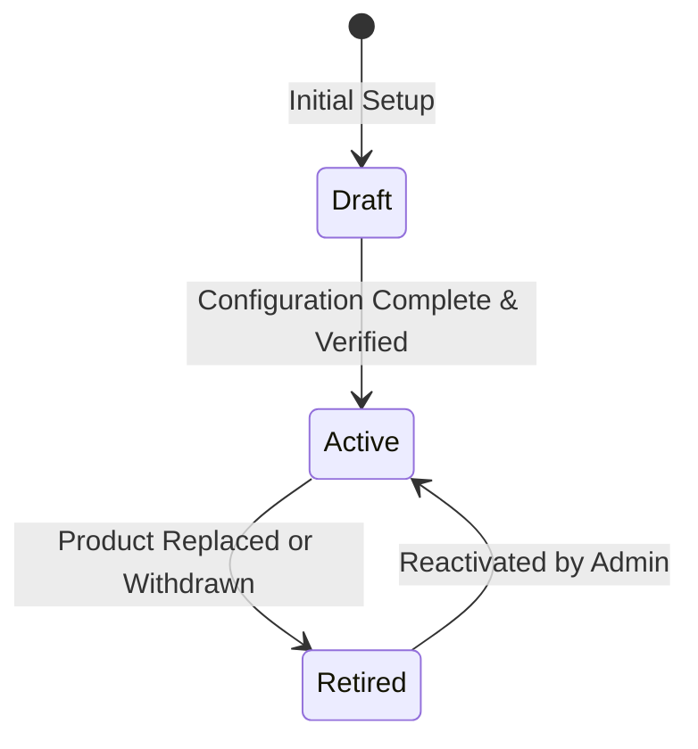

# 51. Products

---

## 1. Overview
The **Products** module (`/admin/products`) configures the commercial profile, operational lifecycle status, statutory Line of Business alignment, and effective date windows of individual insurance products (e.g. `FIRE`, `MARINE`, `WC`, `ENG`). It establishes whether a product is available for public quotation (`active`), undergoing actuarial configuration (`draft`), or closed to new business (`retired`), and identifies the active rating engine (`dynamic` or coded).

---

## 2. Who Can Access
- **Required Permission**: `admin.products`
- **Default Assigned Roles**:
  - `config_admin` (Configuration Administrator)

---

## 3. Screen Walkthrough

### Master Products Table
Rendered via the `EntityManager` component:
- **Header**: "Products".
- **Table Columns**:
  1. `Code`: Unique product key (e.g. `FIRE`, `MARINE`, `WC`, `ENG`).
  2. `Line of business`: Parent statutory line code (`fire`, `marine`, `wc`, `engineering`).
  3. `Name (English)`: Commercial title in English.
  4. `Status`: Operational lifecycle state (`draft`, `active`, `retired`).
  5. `Effective from`: First date available for policy binding.
  6. `Effective to`: Expiration date for new business.
  7. `Rating engine`: Indicates current rater mode (`dynamic` or legacy coded rater).
  8. `Actions`: **Edit** (Creation and deletion of core product records are managed through database migrations).

### Edit Product Form
- **Code**: Displayed as read-only.
- **Line of business** (`line`): Dropdown populated from `lobs`.
- **Name (English)**: Text input.
- **Name (Arabic)**: Text input.
- **Description (English)**: Multi-line commercial summary.
- **Description (Arabic)**: Multi-line Arabic commercial summary.
- **Status**: Select dropdown (`draft`, `active`, `retired`).
- **Effective from**: Date picker.
- **Effective to**: Date picker.
- **Rating engine**: Read-only field displaying `dynamic` (automatically set when a rating model is published).

---

## 4. Field Reference Table

| Field | Type | Required | Allowed Values / Validation | Description | Example |
|---|---|---|---|---|---|
| `code` | String (PK) | Yes | Uppercase alphanumeric; `readonly` | Unique product identifier | `FIRE` |
| `line` | Select (FK) | Yes | Valid code in `lobs` | Parent statutory class | `fire` |
| `name_en` | String | Yes | 2–160 characters | Commercial name in English | `Property – Fire & Allied Perils` |
| `name_ar` | String | Yes | 2–160 characters | Commercial name in Arabic | `الممتلكات – الحريق والمخاطر المرتبطة` |
| `description_en`| Textarea | No | Plain text | Marketing & coverage summary in English | `Business premises, fit-out, equipment and stock...` |
| `description_ar`| Textarea | No | Plain text | Marketing & coverage summary in Arabic | `المباني التجارية والتجهيزات والمعدات والمخزون...` |
| `status` | Select | Yes | `draft`, `active`, `retired` | Commercial availability state | `active` |
| `effective_from`| Date | No | YYYY-MM-DD | Policy binding start date | `2026-01-01` |
| `effective_to` | Date | No | YYYY-MM-DD | Policy binding end date | `2028-12-31` |
| `rater` | String | Auto | `dynamic` or coded name; `readonly` | Active calculation rater | `dynamic` |

---

## 5. Product Lifecycle States

1. **`draft`**: Product is undergoing setup (covers, deductibles, rating models). Visible only to administrators; hidden from customer and broker quotation journeys.
2. **`active`**: Commercial product is live. Available for quotation and policy binding across enabled countries and channels.
3. **`retired`**: Product is withdrawn from the market. New quotes and renewals cannot be initiated; existing active policies continue servicing and claim processing until expiry.

---

## 6. Step-by-Step: Activating a Product for Production
1. Navigate to **Admin** -> **Products** (`/admin/products`).
2. Locate the product in `draft` status (e.g. `FIRE`).
3. Click **Edit**.
4. In the edit modal:
   - Verify that **Line of business** is correctly set to `fire`.
   - Set **Status** to `active`.
   - Set **Effective from** to today's date (or policy launch date).
   - Verify that **Rating engine** displays `dynamic`.
5. *[Screenshot Placeholder: Product Edit Modal with Status set to active]*
6. Click **Save** (`admin.save`).
7. If `products.requireApproval` is enabled, the status change routes to **Pending changes**; otherwise, the product immediately appears in customer and broker quotation menus.

---

## 7. How to Edit / Deactivate / Delete
- **Edit**: Click **Edit** to modify names, descriptions, status, or effective dates.
- **Deactivate**: Change **Status** from `active` to `draft` (temporarily pause sales) or `retired` (permanent market withdrawal).
- **Deletion**: Direct deletion via admin console is disabled (`noDelete: true`) to preserve policyholder contract integrity.

---

## 8. Approval Flow
- **Approval Flag**: `approval: true`.
- If `products.requireApproval` is enabled, saving product modifications submits a change request to `/admin/changes`.
- A checker with `engines.approve` must approve the modification before the product status or dates change.

---

## 9. Dependencies
- **Prerequisites (What must exist BEFORE)**:
  - Parent Line of Business in `lobs`.
  - Active tenant license covering the product's module code (e.g. `FIRE` module).
  - Published rating model in `/admin/rating`.
- **Downstream Consumers (What uses this AFTER)**:
  - Quotation API (`/api/quotes`) checks `status === 'active'` and verifies current date falls within `effective_from` and `effective_to`.
  - Covers, deductibles, discounts, charges, taxes, and rule sets link to `products.code`.

---

## 10. Common Errors & Troubleshooting

| Error Code / Symptom | Cause | Resolution |
|---|---|---|
| Customer sees "Product not available" | Product status is `draft` or `retired`. | Change product status to `active` in `/admin/products`. |
| Quote fails with `INCEPTION_OUT_OF_RANGE` | Cover start date is outside `effective_from` to `effective_to`. | Extend `effective_to` date in `/admin/products`. |
| Cannot create new product | `noCreate: true` is enforced in UI. | Instantiate core product schema keys via migration, then configure parameters via admin console. |

---

## 11. Sample Record: Marine Cargo
- **Code**: `MARINE`
- **Line**: `marine`
- **Name (English)**: `Marine Cargo`
- **Name (Arabic)**: `تأمين البضائع المنقولة`
- **Status**: `active`
- **Rater**: `dynamic`
- **Effective From**: `2026-01-01`

---

## 12. Technical Notes
- **Web Route**: `web/app/[locale]/admin/[entity]/page.js` with `name="products"`.
- **API Endpoints**:
  - `GET /api/platform/entities/products`
  - `PUT /api/platform/entities/products/:code`
- **Database Table**: `products`
