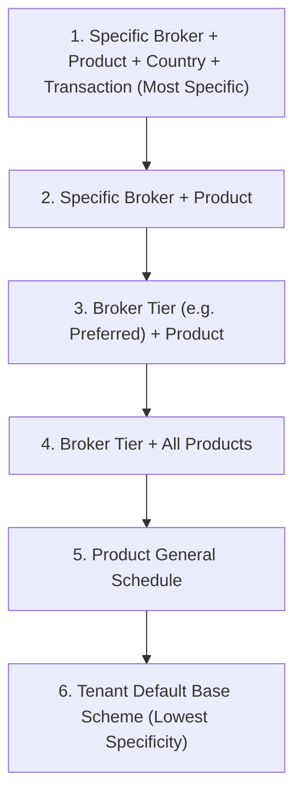

# 60. Commission Schemes

---

## 1. Overview
The **Commission Schemes** module (`/admin/commissionSchemes`) manages intermediary remuneration rules for insurance brokers and agents. It establishes commission rate schedules based on specific broker agencies, broker performance tiers (`standard` vs `preferred`), product lines, jurisdictions, transaction types (`new_business`, `renewal`, `endorsement`), and effective date ranges.

---

## 2. Who Can Access
- **Required Permission**: `admin.commission`
- **Default Assigned Roles**:
  - `config_admin` (Configuration Administrator)
  - `uw_manager` (Underwriting Manager)
  - `ops` (Operations)

---

## 3. Screen Walkthrough

### Master Table & Management Controls
Rendered via the `EntityManager` component:
- **Header**: "Commission schemes" with **Add** button (`admin.add`).
- **Search Bar**: Substring search across scheme names, product codes, and country codes.
- **Table Columns**:
  1. `Name`: Title of the commission agreement (e.g. `Standard Broker Commission`, `Gulf Shield Preferred Fire`).
  2. `Broker (blank = any)`: Specific broker firm or `—` for general tier.
  3. `Broker tier`: Tier level (`standard`, `preferred`, or blank).
  4. `Product (blank = all)`: Scoped product code.
  5. `Rate (0.15 = 15%)`: Commission rate percentage.
  6. `From`: Effective start date (`effective_from`).
  7. `Active`: Status checkmark (`✓` or `✗`).
  8. `Actions`: **Edit** and **Delete**.

### Creation / Edit Modal
- **Name**: Required scheme title.
- **Broker (blank = any)** (`broker_id`): Select dropdown pulling registered firms from `brokers`.
- **Broker tier**: Select dropdown (`""`, `standard`, `preferred`).
- **Product (blank = all)**: Product code text input (e.g. `FIRE`).
- **Country (blank = all)**: Country code text input (e.g. `AE`).
- **Transactions (blank = all)**: JSON array specifying applicable transaction types. Hint: `["new_business","renewal","endorsement"]`.
- **Rate (0.15 = 15%)**: Required decimal fraction (`0.15` for 15%).
- **From** (`effective_from`): Required effective start date.
- **To** (`effective_to`): Expiration date or blank for indefinite validity.
- **Active**: Checkbox toggle.

---

## 4. Field Reference Table

| Field | Type | Required | Allowed Values / Validation | Description | Example |
|---|---|---|---|---|---|
| `id` | Integer (PK) | Auto | Positive integer | Unique scheme record ID | `1` |
| `name` | String | Yes | 2–160 characters | Administrative contract title | `Gulf Shield Preferred Fire Terms` |
| `broker_id` | Select (FK) | No | Valid ID in `brokers` or null | Specific broker agency assignment | `1` (Gulf Shield) |
| `broker_tier` | Select | No | `""`, `standard`, `preferred` | Agency tier grouping | `preferred` |
| `product_code` | String | No | Valid product or blank | Product scope (blank = all) | `FIRE` |
| `country_code` | String | No | 2-char country code or blank | Country scope (blank = all) | `AE` |
| `transactions` | JSON | No | `["new_business", "renewal", ...]` | Eligible transaction events | `["new_business", "renewal"]` |
| `rate` | Number | Yes | `0 <= rate <= 0.5` | Commission percentage fraction | `0.15` |
| `effective_from`| Date | Yes | YYYY-MM-DD | Agreement start date | `2026-01-01` |
| `effective_to` | Date | No | YYYY-MM-DD | Agreement end date | `2026-12-31` |
| `active` | Boolean | Yes | `true`, `false` | Active evaluation state | `true` |

---

## 5. Specificity & Resolution Hierarchy

When a policy is bound by a broker, the platform identifies all active commission schemes matching the policy's inception date, and selects the **single most specific** matching scheme according to the following resolution hierarchy:

*Example*: If Gulf Shield Insurance Brokers has a custom agreement for `FIRE` at 17.5%, and the standard broker tier offers `FIRE` at 12.5%, the system awards Gulf Shield 17.5% because agency-specific rules supersede tier-wide rules.

---

## 6. Step-by-Step: Adding a Preferred Broker Commission Scheme
1. Navigate to **Admin** -> **Commission schemes** (`/admin/commissionSchemes`).
2. Click **Add** (`admin.add`).
3. In the modal:
   - **Name**: `Emirates Premier Preferred Marine Rate`.
   - **Broker**: Select `Emirates Premier Insurance Brokers`.
   - **Broker tier**: Select `preferred`.
   - **Product**: Enter `MARINE`.
   - **Country**: Enter `AE`.
   - **Transactions**: `["new_business", "renewal"]`.
   - **Rate**: `0.18` (18%).
   - **From**: Enter today's date (e.g. `2026-01-01`).
   - **Active**: Checked.
4. *[Screenshot Placeholder: Add Commission Scheme Form showing 18% for Emirates Premier]*
5. Click **Save** (`admin.save`).
6. All new marine cargo policies bound by Emirates Premier broker users will automatically calculate an 18% broker commission line in table `commissions`.

---

## 7. How to Edit / Deactivate / Delete
- **Edit**: Click **Edit** to adjust commission rates, tier assignments, or expiration dates.
- **Deactivate**: Uncheck **Active** to suspend a scheme.
- **Delete**: Click **Delete** and confirm prompt. Historical earned commissions retain their historical recorded rates even if the parent scheme is deleted.

---

## 8. Approval Flow
- Commission scheme configurations take effect immediately and do **not** enter the `Pending changes` approval queue.
- Updates are audited under `config.commissionSchemes.create`, `config.commissionSchemes.update`, and `config.commissionSchemes.delete`.

---

## 9. Dependencies
- **Prerequisites (What must exist BEFORE)**:
  - Broker entity registered in `brokers`.
  - Product registered in `products`.
- **Downstream Consumers (What uses this AFTER)**:
  - Policy binding engine (`/api/quotes/:id/bind`) evaluates matching schemes and inserts an `earned` commission ledger row.
  - Commission Payouts module (`/admin/commissions`) manages the financial settlement of earned records.
  - Broker dashboard displays real-time earned commission statements.

---

## 10. Business Rules & Validations
1. **Commission Rate Ceiling**: Commission rates cannot exceed 50% (`0.50`) and cannot be negative. Submitting an out-of-range number throws HTTP 400 `RATE_OUT_OF_RANGE`:
   *"Commission rate must be between 0 and 0.5"*.
2. **Effective Dates**: The scheme is only eligible if the policy binding date falls between `effective_from` and `effective_to`.
3. **Clawback Generation**: If an active policy is cancelled mid-term or has its sum insured decreased via endorsement, the system creates a compensating negative commission record (`status = 'clawback'`) calculated using the same scheme rate.

---

## 11. Common Errors & Troubleshooting

| Error Code | Cause | Resolution |
|---|---|---|
| `RATE_OUT_OF_RANGE` | Rate entered as whole number (e.g. `15` instead of `0.15`). | Enter commission rate as a decimal fraction (e.g. `0.15` for 15%). |
| Commission not calculated on bind | Quote was bound by direct customer, or broker has no matching scheme. | Verify that the quote was bound by a broker user and that an active scheme covers the product. |

---

## 12. Technical Notes
- **Web Route**: `web/app/[locale]/admin/[entity]/page.js` with `name="commissionSchemes"`.
- **API Endpoints**:
  - `GET /api/platform/entities/commissionSchemes`
  - `POST /api/platform/entities/commissionSchemes`
  - `PUT /api/platform/entities/commissionSchemes/:id`
  - `DELETE /api/platform/entities/commissionSchemes/:id`
- **Database Table**: `commission_schemes`
- **Order Index**: `['id']`
