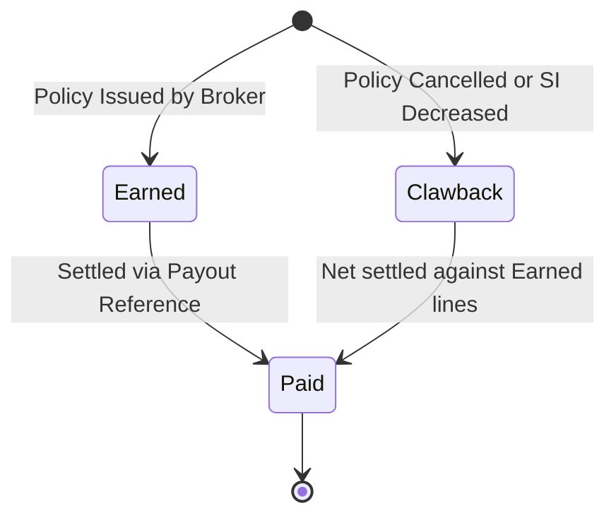

# 61. Commission Payouts

---

## 1. Overview
The **Commission Payouts** module (`/admin/commissions`) provides the financial settlement workbench for broker commissions. Finance and operations personnel use this module to inspect earned broker commissions and mid-term clawback reversals, view net outstanding balances by broker firm, select batches of eligible lines, and record settlement with bank transfer references to transition commission records from `earned`/`clawback` to `paid`.

---

## 2. Who Can Access
- **Required Permission**: `admin.commission`
- **Default Assigned Roles**:
  - `config_admin` (Configuration Administrator)
  - `uw_manager` (Underwriting Manager)
  - `ops` (Operations)

---

## 3. Screen Walkthrough

### Master Financial Settlement Workbench
- **Header**: "Commission payouts" (`admin.commissions`).
- **Status Filter**: Dropdown allowing filtering between:
  - `Earned / Clawback` (`earned,clawback`): Unsettled commission ledger lines.
  - `Paid` (`paid`): Historical settled payouts.
- **Broker Totals Summary Bar**: Displays dynamic pill badges for each broker with their net unpaid commission total (e.g. `Gulf Shield Insurance Brokers: AED 14,250.00`).
- **Commissions Table**:
  1. `Select All Checkbox`: Allows one-click bulk selection of all displayed lines.
  2. `Broker`: Name of the licensed broker firm.
  3. `Policy`: Active policy reference number (e.g. `AE-FIR-B2B-2026-000105`).
  4. `Transaction`: Originating transaction (`new_business`, `renewal`, `endorsement`).
  5. `Rate`: Applied commission percentage (e.g. `15.0%`).
  6. `Amount`: Monetary commission sum (positive for earned, negative for clawbacks).
  7. `Status`: Status badge (`earned`, `clawback`, or `paid` with attached `payoutRef`).
  8. `Date`: Formatted inception or settlement date.

### Payout Settlement Bar
Rendered at the bottom of the table when viewing unsettled lines:
- **Payout reference** (`pr`): Text input to enter the bank wire reference or cheque voucher number (minimum 2 characters).
- **Mark selected as paid Button**: Submits payment batch, transitions status to `paid`, stores `payout_ref`, and resets selection.

---

## 4. Field Reference Table

| Field | Type | Required | Allowed Values / Validation | Description | Example |
|---|---|---|---|---|---|
| `id` | Integer (PK) | Auto | Positive integer | Unique commission ledger ID | `301` |
| `broker` | String | Auto | Name of broker firm | Broker firm name | `Gulf Shield Insurance Brokers` |
| `broker_id` | Integer (FK) | Yes | Valid ID in `brokers` | Broker entity key | `1` |
| `policy_id` | Integer (FK) | Yes | Valid ID in `policies` | Linked policy record | `105` |
| `policy_no` | String | Auto | Formatted policy number | Policy identification string | `AE-FIR-B2B-2026-000105` |
| `transaction` | Enum | Yes | `new_business`, `renewal`, `endorsement` | Triggering policy event | `new_business` |
| `base_amount` | Number | Yes | Monetary float | Premium base upon which rate applied | `10000.00` |
| `rate` | Number | Yes | Decimal fraction | Commission percentage applied | `0.15` |
| `amount` | Number | Yes | Positive or negative float | Net commission calculated | `1500.00` |
| `status` | Enum | Yes | `earned`, `clawback`, `paid` | Settlement state | `earned` |
| `scheme_id` | Integer (FK) | Yes | Valid ID in `commission_schemes` | Applied commission scheme | `1` |
| `payout_ref` | String | Conditional | Max 80 characters | Wire transfer or voucher reference | `WIRE-202610-GS-001` |
| `paid_at` | Timestamp | No | ISO Timestamp | Date and time payout recorded | `2026-10-22 15:00:00` |
| `currency` | String | Yes | 3-character ISO currency | Settlement currency | `AED` |

---

## 5. Settlement Lifecycle & Clawbacks

### Netting Logic (Earned vs Clawback)
If a broker issues three policies earning AED 1,000 each (Total: AED 3,000) and cancels an earlier policy resulting in a clawback of -AED 500, the broker totals bar displays:
`Broker Total: AED 2,500.00`
Selecting all four rows settles the entire batch for a net payment of AED 2,500 under a single bank wire reference.

---

## 6. Step-by-Step: Processing a Commission Payout Batch
1. Sign in as an Operations specialist (`ops@portal.test`) or Administrator.
2. Navigate to **Admin** -> **Commission payouts** (`/admin/commissions`).
3. Verify that the **Status** filter is set to `Earned / Clawback`.
4. Review the broker summary pills at the top to identify which agencies have balances due.
5. In the table, select the checkboxes for the specific broker being settled (or click the header checkbox to select all).
6. *[Screenshot Placeholder: Commission Payouts Screen showing selected lines and Payout Ref]*
7. In the **Payout reference** field, enter the bank remittance reference:
   `FAB-WIRE-2026-OCT-094`
8. Click **Mark selected as paid** (`admin.markPaid`).
9. The system executes the update, displays a green success notice (e.g. `4 ✓`), and refreshes the ledger.
10. To inspect historical settled payouts, switch the **Status** filter to `Paid`.

---

## 7. How to Edit / Deactivate / Delete
- **Immutability**: Commission ledger lines cannot be deleted or manually edited through the administration console.
- **Clawbacks**: If an adjustment is needed due to contract changes, the policy servicing workflow automatically inserts compensating `clawback` records.

---

## 8. Approval Flow
- Payout settlements apply immediately upon clicking **Mark selected as paid**.
- The settlement action is audited under `action: 'commission.pay'` with the list of affected commission IDs, payout reference, and count of records settled.

---

## 9. Dependencies
- **Prerequisites (What must exist BEFORE)**:
  - Commission schemes in `/admin/commissionSchemes`.
  - Policies bound by broker users resulting in `earned` commission rows.
- **Downstream Consumers (What uses this AFTER)**:
  - Broker statements in the Broker Portal dashboard display updated "Paid" statuses and wire references.

---

## 10. Common Errors & Troubleshooting

| Error Code / Symptom | Cause | Resolution |
|---|---|---|
| "Mark selected as paid" button disabled | No rows are selected or payout reference has fewer than 2 characters. | Select at least one commission row and enter a valid bank reference (e.g. `WIRE-123`). |
| Expected commission missing | Policy was bound on credit or card by a direct customer rather than a broker user. | Verify the policy author in `/admin/audit`; commissions only accrue on broker-bound policies. |

---

## 11. Sample Payout Record
- **ID**: `482`
- **Broker**: `Gulf Shield Insurance Brokers`
- **Policy**: `AE-FIR-B2B-2026-000105`
- **Transaction**: `new_business`
- **Base Amount**: `AED 20,000.00`
- **Rate**: `15.0%`
- **Amount**: `AED 3,000.00`
- **Status**: `paid`
- **Payout Reference**: `WIRE-GS-2026-10-01`
- **Paid At**: `2026-10-22 15:30:00`

---

## 12. Technical Notes
- **Web Route**: `web/app/[locale]/admin/commissions/page.js`
- **API Endpoints**:
  - `GET /api/platform/commissions?status={earned,clawback|paid}&brokerId={id}`
  - `POST /api/platform/commissions/pay` (requires `admin.commission`, payload: `{ ids: number[], reference: string }`)
- **Database Tables**: `commissions`, `brokers`, `policies`.
