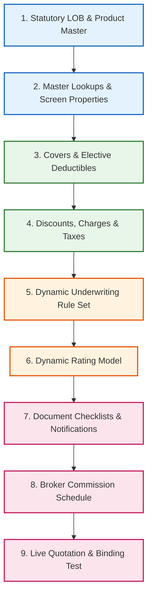

# 90. End-to-End Walkthrough: Launching a New Insurance Product

This guide demonstrates a complete, step-by-step administrative walkthrough for launching a brand-new product line from scratch on the platform: **Motor Comprehensive Insurance (`MOTOR`)**.

By following this sequence, a team consisting of a **Maker** (`config1@portal.test`) and a **Checker** (`config2@portal.test`) will configure the statutory line of business, product master, coverage add-ons, elective deductibles, automatic discounts, policy fees, VAT taxes, underwriting referral rules, dynamic rating models, document requirements, and broker commission agreements.

---

## Architecture of the Product Launch Flow



---

## Phase 1: Statutory Line of Business & Master Data

### Step 1: Create the Line of Business (`/admin/lobs`)
1. Log in as `config1@portal.test` (Maker).
2. Navigate to **Admin** -> **Lines of business** (`/admin/lobs`). Click **Add**.
3. Fill in the statutory definition:
   - **Code**: `motor`
   - **Name (English)**: `Motor Vehicle Insurance`
   - **Name (Arabic)**: `تأمين المركبات والسيارات`
   - **Description**: `Commercial and private motor vehicle loss and third-party liabilities.`
   - **Order**: `5`
   - **Active**: Checked.
4. Click **Save**.

### Step 2: Register Master Drop-Down Lists & Values
1. Navigate to **Admin** -> **Drop-down lists** (`/admin/lookupLists`). Click **Add**:
   - **Code**: `MOTOR.bodyTypes`
   - **Name**: `Motor Vehicle Body Types`
   - **Product**: `MOTOR`
   - Click **Save**.
2. Navigate to **Admin** -> **Drop-down values** (`/admin/lookupValues`). Click **Add** for each choice:
   - Choice A: `list_code = 'MOTOR.bodyTypes'`, `code = 'sedan'`, `label_en = 'Saloon / Sedan'`, `label_ar = 'صالون / سيدان'`, `sort = 10`.
   - Choice B: `list_code = 'MOTOR.bodyTypes'`, `code = 'suv'`, `label_en = '4x4 / SUV'`, `label_ar = 'دفع رباعي / جيب'`, `sort = 20`.
   - Choice C: `list_code = 'MOTOR.bodyTypes'`, `code = 'coupe'`, `label_en = 'Sports Coupe'`, `label_ar = 'كوبيه رياضية'`, `attributes = {"isSportsCar": true}`, `sort = 30`.

### Step 3: Configure UI Field Properties (`/admin/fieldDefinitions`)
1. Navigate to **Admin** -> **Field properties** (`/admin/fieldDefinitions`). Click **Add**:
   - **Screen**: `motor.vehicle`
   - **Field**: `chassisNo`
   - **Label (English)**: `Chassis / VIN Number`
   - **Label (Arabic)**: `رقم الشاسيه / الهيكل`
   - **Tooltip (English)**: `17-digit Vehicle Identification Number stamped on vehicle registration card.`
   - **Pattern**: `^[A-HJ-NPR-Z0-9]{17}$`
   - **Mandatory**: Checked.
   - Click **Save**.

---

## Phase 2: Coverage, Deductibles, Pricing Adjustments & Taxes

### Step 4: Configure Product Covers (`/admin/productCovers`)
1. Navigate to **Admin** -> **Covers** (`/admin/productCovers`).
2. Add the mandatory core cover:
   - **Product**: `MOTOR` | **Code**: `P01` | **Type**: `basic`
   - **Name**: `Accidental Damage & Collision` (`أضرار الحوادث والتصادم`)
   - **Pricing**: `null` (Included in technical base rate).
   - Click **Save**.
3. Add the elective commercial add-on:
   - **Product**: `MOTOR` | **Code**: `X01` | **Type**: `optional`
   - **Name**: `Agency Repair Extension` (`إصلاح الوكالة`)
   - **Pricing**: `{"method": "loading", "pct": 0.15}` (15% loading on base premium).
   - Click **Save**.
4. Add the car hire add-on:
   - **Product**: `MOTOR` | **Code**: `X02` | **Type**: `optional`
   - **Name**: `Car Hire Replacement (7 Days)` (`سيارة بديلة مؤقتة`)
   - **Pricing**: `{"method": "fixed", "amount": 200}` (Flat AED 200).
   - Click **Save**.

### Step 5: Configure Deductible Options (`/admin/productDeductibles`)
1. Navigate to **Admin** -> **Deductibles** (`/admin/productDeductibles`).
2. Add the standard option:
   - **Product**: `MOTOR` | **Code**: `standard`
   - **Name**: `Standard Excess (AED 500)` (`التحمل القياسي`)
   - **Type**: `fixed` | **Amount**: `500` | **Rating factor**: `1.0`
   - **Default**: Checked (`true`).
   - Click **Save**.
3. Add the voluntary high excess tier:
   - **Product**: `MOTOR` | **Code**: `high`
   - **Name**: `High Excess (AED 1,000 - 10% Off)` (`تحمل مرتفع - خصم 10%`)
   - **Type**: `fixed` | **Amount**: `1000` | **Rating factor**: `0.90` (10% premium reduction).
   - Click **Save**.

### Step 6: Configure Automatic Discounts & Fees (`/admin/premiumAdjustments`, `/admin/charges`)
1. Navigate to **Discounts and loadings** (`/admin/premiumAdjustments`):
   - **Code**: `MOTOR_NCD_1Y` | **Kind**: `discount` | **Percent**: `0.05` (5%)
   - **Condition**: `{"fact": "claims3y", "op": "eq", "value": 0}`
   - **Stackable**: `true` | **Priority**: `10`
   - Click **Save**.
2. Navigate to **Charges and fees** (`/admin/charges`):
   - **Code**: `MOTOR_ISSUANCE_FEE` | **Name**: `Policy Issuance Fee`
   - **Type**: `fixed` | **Amount**: `75` | **Taxable**: `true`
   - **Transactions**: `["new_business", "renewal"]`
   - Click **Save**.

### Step 7: Configure Taxes (`/admin/taxes`)
1. Navigate to **Admin** -> **Taxes** (`/admin/taxes`):
   - Verify that standard UAE 5% VAT (`VAT`) is configured with `country_code = 'AE'` and `applies_to_fees = true`.

---

## Phase 3: Dynamic Engines (Rules & Rating)

### Step 8: Build and Publish Underwriting Rule Set (`/admin/rules`)
1. Navigate to **Admin** -> **Rule sets** (`/admin/rules`).
2. Create set `MOTOR_UW` for purpose `underwriting`.
3. Add Rule 1 (Decline Underage Drivers):
   - **Code**: `DEC-MOTOR-AGE` | **Action**: `decline`
   - **Condition**: `driver.age < 21`
   - **Name**: `Drivers under 21 years of age are not quotable online.`
4. Add Rule 2 (High Value Referral):
   - **Code**: `REF-MOTOR-HIGH-VAL` | **Action**: `refer`
   - **Condition**: `vehicle.value > 300000`
   - **Name**: `Vehicle value exceeds AED 300,000; requires underwriter review.`
5. In the **Test bench**, add test cases:
   - Case A: `{"driver": {"age": 19}}` -> Asserts `decline = ["DEC-MOTOR-AGE"]`.
   - Case B: `{"vehicle": {"value": 350000}, "driver": {"age": 30}}` -> Asserts `refer = ["REF-MOTOR-HIGH-VAL"]`.
6. Click **Run tests** -> Verify 100% pass (`✓`).
7. Click **Submit for approval**.
8. Sign in as `config2@portal.test` (Checker) -> Open set -> Click **Approve and publish**.

### Step 9: Build and Publish Dynamic Rating Model (`/admin/rating`)
1. Log in as `config1@portal.test`.
2. Navigate to **Admin** -> **Rating models** (`/admin/rating`).
3. Click **New version** under `MOTOR`.
4. Enter the calculation JSON tree:
   ```json
   {
     "name": "Motor Comprehensive Rating Engine",
     "steps": [
       { "set": "vehicleValue", "value": "num(risk.vehicle.value ?? 50000)" },
       { "set": "baseRate", "value": "risk.vehicle.bodyType == 'coupe' ? 0.035 : 0.025" },
       { "set": "ownDamagePremium", "value": "max(vehicleValue * baseRate, 1200)" },
       { "set": "agencyRepair", "value": "includes(risk.extensions, 'X01') ? ownDamagePremium * 0.15 : 0" },
       { "set": "carHire", "value": "includes(risk.extensions, 'X02') ? 200 : 0" },
       { "set": "deductibleFactor", "value": "num(risk.deductibleFactor ?? 1.0)" },
       {
         "checkpoint": "technicalPremium",
         "value": "(ownDamagePremium + agencyRepair + carHire) * deductibleFactor"
       },
       { "set": "policyFee", "value": "75" },
       { "set": "taxableAmount", "value": "technicalPremium + policyFee" },
       { "set": "tax", "value": "taxableAmount * 0.05" },
       { "checkpoint": "total", "value": "taxableAmount + tax" }
     ]
   }
   ```
5. On the **Test bench**, enter a sample risk:
   ```json
   {
     "vehicle": { "value": 100000, "bodyType": "suv" },
     "extensions": ["X01"],
     "deductibleFactor": 0.90
   }
   ```
6. Click **Price on draft and live** -> Verify:
   - Own Damage: `100,000 * 0.025 = AED 2,500`
   - Agency Repair: `2,500 * 15% = AED 375`
   - Subtotal: `AED 2,875 * 0.90 = AED 2,587.50` (Technical Premium)
   - Fee: `AED 75` -> Subtotal: `AED 2,662.50`
   - VAT (5%): `AED 133.13`
   - Total: **AED 2,795.63**
7. Click **Submit for approval**.
8. Sign in as `config2@portal.test` -> Click **Approve and publish**. The system automatically sets `products.rater = 'dynamic'`.

---

## Phase 4: Operational Evidence & Intermediary Remuneration

### Step 10: Configure Document Requirements (`/admin/documentRequirements`)
1. Log in as `config1@portal.test`.
2. Navigate to **Document requirements** (`/admin/documentRequirements`):
   - Add Item 1: `event = 'claim'`, `doc_type = 'police_report'`, `mandatory = true`, `note_en = 'Official Police Traffic Accident Report'`.
   - Add Item 2: `event = 'claim'`, `doc_type = 'photo'`, `mandatory = true`, `note_en = 'Photos of damaged vehicle panels before repair'`.
   - Add Item 3: `event = 'policy'`, `doc_type = 'trade_licence'`, `mandatory = false` (optional).

### Step 11: Configure Commission Scheme (`/admin/commissionSchemes`)
1. Navigate to **Commission schemes** (`/admin/commissionSchemes`):
   - Click **Add**.
   - **Name**: `Motor Preferred Broker Terms`
   - **Broker tier**: `preferred`
   - **Product**: `MOTOR`
   - **Country**: `AE`
   - **Transactions**: `["new_business", "renewal"]`
   - **Rate**: `0.15` (15%)
   - **From**: Today's date.
   - Click **Save**.

---

## Phase 5: Verification, Quoting, and Binding

### Step 12: Activating the Product in Catalogue (`/admin/catalogue`, `/admin/products`)
1. Navigate to **Admin** -> **Products** (`/admin/products`).
2. Locate `MOTOR`. Set **Status** to `active`. Click **Save**.
3. Open **Admin** -> **Products** (`/admin/catalogue`):
   - Verify that the `MOTOR` card displays:
     - Status: `active`
     - Engine: `dynamic`
     - Covers: `basic: 1/1 · optional: 2/2`
     - Deductibles: `2`
     - Adjustments: `MOTOR_NCD_1Y`
     - Charges: `MOTOR_ISSUANCE_FEE: AED 75`
     - Taxes: `1`

### Step 13: Execute Live End-to-End Test Journey
1. Sign in as a broker user (`sara@gulfshield.test`).
2. Start a new quotation for **Motor Comprehensive**:
   - Vehicle: 2024 Toyota Land Cruiser SUV, Value AED 180,000.
   - Driver Age: 34, Claims in last 3 years: 0.
   - Extensions: Check **Agency Repair**.
   - Deductible: Select **High Excess (AED 1,000)**.
3. Review Price:
   - 5% No-Claims Discount is applied automatically.
   - 10% High Excess rating factor discount applies.
   - AED 75 issuance fee is added.
   - 5% VAT is computed on both premium and fee.
4. Bind policy using Broker Credit account.
5. Verify Generated Records:
   - Policy Schedule is issued: `MOT-AE-B2B-2026-000001`.
   - Tax Invoice generated with itemized VAT breakdown.
   - Navigate to `/admin/commissions`: Confirm an `earned` commission record exists for Gulf Shield for 15% of the net premium.
   - Navigate to `/admin/audit`: Confirm all transactions are recorded in the immutable audit log.
